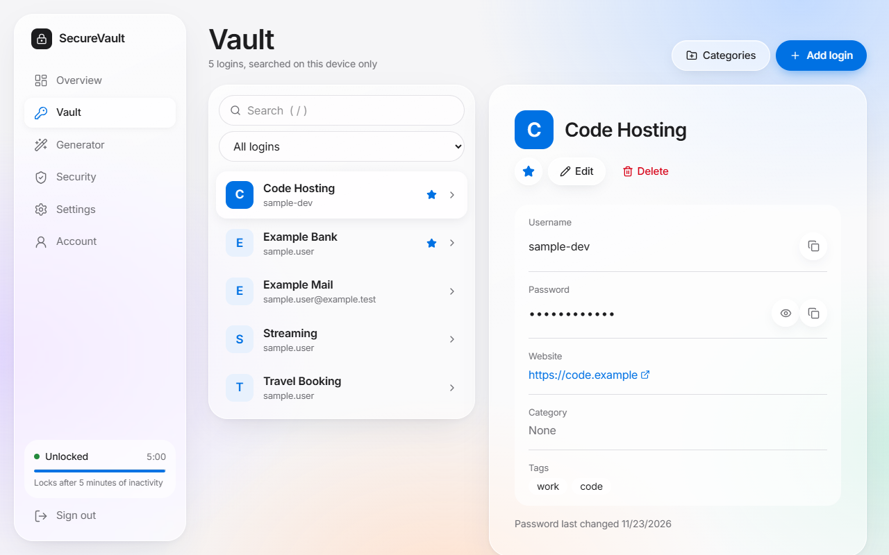
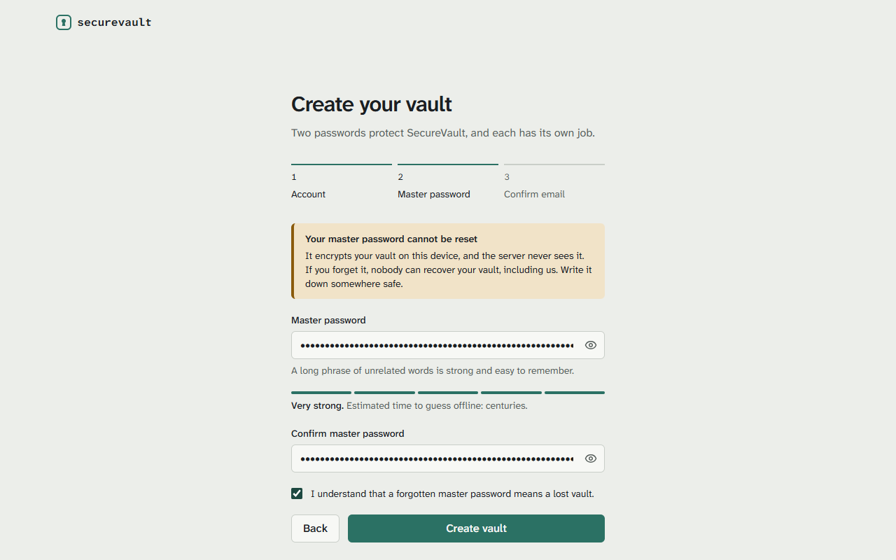
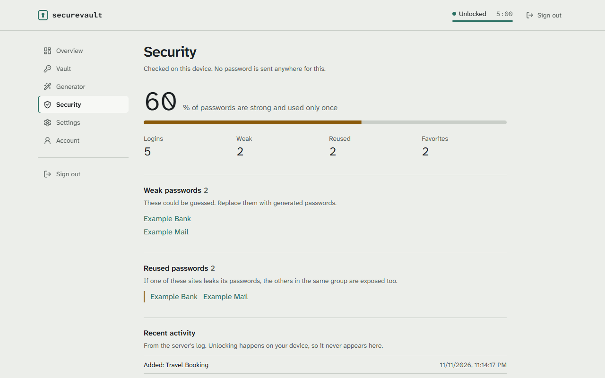
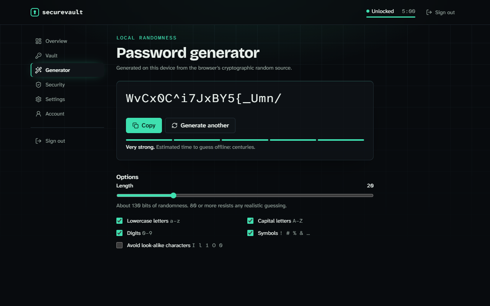
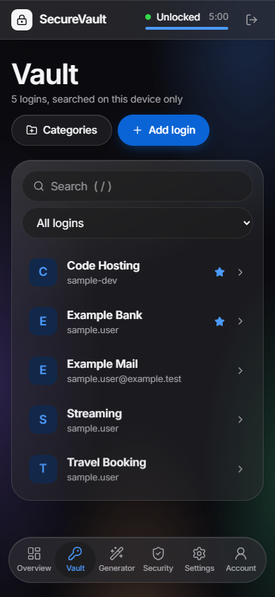
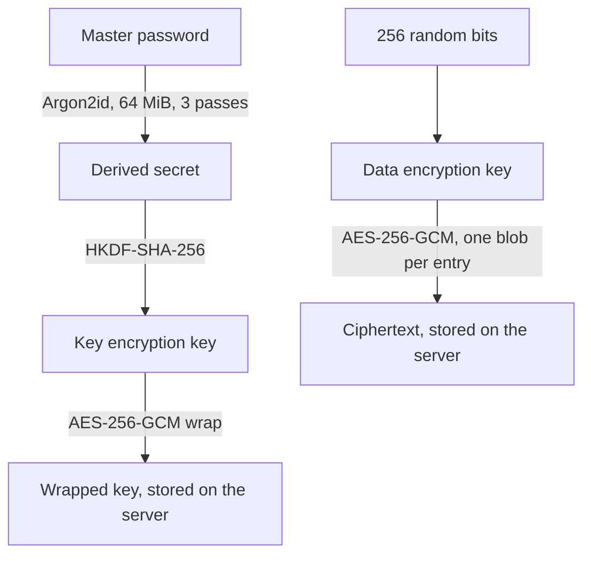

# SecureVault

A zero-knowledge password manager. Your vault is encrypted in the browser with a key derived from your master password, and the server stores only data it cannot read.

Built with Spring Boot, React, and PostgreSQL as a security engineering project.

> **Not for real passwords.** SecureVault has had no independent security assessment. The [self-review](docs/SECURITY_AUDIT.md) found no open critical or high issues, but that is not the same as an audit. Use it to learn from, not to protect accounts you care about.



## What it does

- **Two passwords with separate jobs.** An account password signs you in and can be reset by email. A master password unlocks the vault, never leaves your device, and cannot be reset by anyone.
- **Whole-entry encryption.** Name, username, password, websites, notes, tags, category, and favorite flag are sealed together with AES-256-GCM, so the server cannot tell which sites you use.
- **Vault tools.** Search, categories, tags, favorites, a password generator, and local strength estimates.
- **Security overview.** Weak, reused, old, and empty passwords, found on your device without sending anything out.
- **Locking.** Auto-lock after inactivity, a countdown in the header that locks on click, and locking across tabs.
- **Encrypted backup.** Download the whole vault as a file sealed with a separate backup passphrase, and import it into any vault. The file is made and opened on your device.
- **Account controls.** Session list with sign-out, account password change, vault reset, and account deletion.
- **Light and dark themes,** laid out for phone, tablet, and desktop.

| Sign-up, with the master password warning | Security overview |
|---|---|
|  |  |

| Password generator, dark theme | Vault on a phone, dark theme |
|---|---|
|  |  |

The screenshots are captured from the running app by [`e2e/screenshots.mjs`](e2e/screenshots.mjs) and show made-up sample data.

## How the encryption works



Everything in that diagram happens in the browser. The server receives the wrapped key and the ciphertext, and holds nothing that can open either. Unlocking is proven by the wrapped key decrypting, so the server keeps no verifier for the master password.

No cryptographic primitive is implemented here. The app uses the browser's Web Crypto API, [`hash-wasm`](https://github.com/Daninet/hash-wasm) for Argon2id, and Bouncy Castle through Spring Security on the server.

More detail: [security architecture](docs/SECURITY_ARCHITECTURE.md), the full [specification](docs/ARCHITECTURE.md), and the [threat model](THREAT_MODEL.md).

## What it does not protect against

- **A compromised server sending modified code.** It could capture your master password the next time you unlock. Every password manager that runs as a web page shares this limit.
- **Malware or a malicious browser extension** on your device while the vault is unlocked.
- **A weak master password,** if the database is ever stolen.
- **A forgotten master password.** The vault cannot be recovered.
- **A server that rolls back or deletes entries.** It cannot forge or swap them, but it could serve an older copy.

The server can also see how many entries you have, their sizes in 256-byte steps, and when they change.

## Run it

You need Docker Desktop. From the repository root:

```bash
cp .env.example .env
```

Set `POSTGRES_PASSWORD` in `.env`, then:

```bash
docker compose up --build --wait
```

Open <http://localhost:3000> and create a vault. Sign-up sends a confirmation email, which is caught locally by Mailpit instead of being delivered: read it at <http://localhost:8025>.

The stack serves plain HTTP for local use. A real deployment would need TLS in front of it and the `prod` profile, and has not been attempted.

## Develop and test

Requirements: JDK 25, Node.js 26 (24.15 or newer also works), and Docker for the integration and end-to-end tests. Maven comes with the wrapper.

Backend, from `backend/`. `verify` runs unit tests, integration tests on a real PostgreSQL through Testcontainers, and the format check. On Windows use `mvnw.cmd`:

```bash
./mvnw verify
```

Frontend, from `frontend/`:

```bash
npm ci
```

```bash
npm run lint && npm run typecheck && npm test && npm run build
```

End-to-end, with the stack running. See [`e2e/README.md`](e2e/README.md):

```bash
npm ci && npx playwright test
```

### Test status

Last run locally on 2026-11-22:

| Suite | Result |
|---|---|
| Backend unit and integration | 104 tests pass |
| Frontend unit and component | 187 tests pass |
| End-to-end in a real browser | 4 tests pass |

The end-to-end journey puts a unique marker in the master password and every entry field, then fails if any marker appears in network traffic, a database row, or a log.

The GitHub Actions workflows in this repository have not run yet.

## Project layout

```
backend/    Spring Boot API: accounts, sessions, encrypted record storage
frontend/   React app: crypto, vault session, screens
e2e/        Playwright tests against the full Docker stack
docs/       Architecture, API, database, audit, decision records
```

## Documentation

- [Security architecture](docs/SECURITY_ARCHITECTURE.md): how the pieces fit, for a first read
- [Architecture and cryptographic specification](docs/ARCHITECTURE.md)
- [Threat model](THREAT_MODEL.md) and [security audit](docs/SECURITY_AUDIT.md)
- [API specification](docs/API_SPECIFICATION.md) and [database design](docs/DATABASE_DESIGN.md)
- [Architecture decision records](docs/adr/README.md)
- [Final report](docs/FINAL_REPORT.md): what was delivered, tested, and left open
- [Reporting a vulnerability](SECURITY.md), [contributing](CONTRIBUTING.md), [changelog](CHANGELOG.md)

## Not built yet

Sharing, two-factor sign-in, a browser extension, and rotation of the data encryption key.

## License

[MIT](LICENSE)
