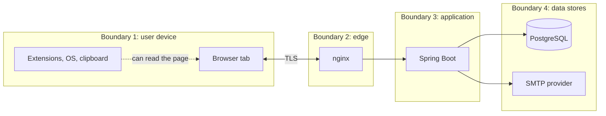

# SecureVault Threat Model

**Status:** Written in Phase 0 and re-checked in Phase 6. The mitigations are implemented unless a row says otherwise. Which ones are tested, reviewed, or accepted is recorded per scenario in [docs/SECURITY_AUDIT.md](docs/SECURITY_AUDIT.md). That audit is a self-review, not an independent assessment.

SecureVault has not had an independent security assessment. It is a portfolio project and should not be used to store real credentials.

Cryptographic details are in [docs/ARCHITECTURE.md](docs/ARCHITECTURE.md), section 5.

## 1. What "zero-knowledge" means here

**The claim:** the server stores vault data in a form it cannot decrypt, and the software as designed never sends it the master password or vault keys.

**What the claim does not mean:** that a compromised server is harmless. Because the browser downloads the application from the server each time, whoever controls the server could deliver modified code that steals the master password. The design strongly protects against database theft and server-side snooping on stored data. It does not protect against an attacker actively modifying the application.

## 2. Assets

| ID | Asset | Sensitivity |
|---|---|---|
| A1 | Master password | Critical; only in browser memory during use |
| A2 | DEK and KEK | Critical; only in browser memory |
| A3 | Decrypted vault contents | Critical; only in browser memory while unlocked |
| A4 | Wrapped DEK, KDF parameters | High; offline guessing target |
| A5 | Record ciphertext | High; protected by the DEK |
| A6 | Account password and hash | High; gives account access but not vault contents |
| A7 | Session IDs, CSRF tokens | High; gives ciphertext access and destructive actions subject to step-up |
| A8 | Email address, activity events, timestamps | Medium; personal data |
| A9 | Reset and verification tokens | High while valid |
| A10 | Application code delivered to the browser | Critical; controls A1 to A3 |

## 3. Actors

| ID | Actor | Capability |
|---|---|---|
| T1 | Anonymous internet attacker | Sends requests, runs credential stuffing, tries enumeration and CSRF |
| T2 | Other authenticated user | Valid session; attempts to reach others' data |
| T3 | Database thief | Reads a full database backup or dump |
| T4 | Honest-but-curious operator | Reads server logs and the database but does not change the code |
| T5 | Active server compromise | Modifies stored data, API responses, or served code |
| T6 | Network attacker | Intercepts traffic; blocked by TLS unless the certificate model fails |
| T7 | XSS or malicious browser extension | Runs JavaScript in the page |
| T8 | Local attacker or malware | Access to an unlocked device or to its memory |
| T9 | Supply-chain attacker | Compromises a dependency or build step |

## 4. Trust boundaries

Data crossing from Boundary 1 to Boundary 2 must never include A1, A2, or A3. This is verified by canary-based end-to-end tests.

## 5. Attack scenarios

**Status per row:** see the table in [docs/SECURITY_AUDIT.md](docs/SECURITY_AUDIT.md).

### Database and server-side exposure

| # | Scenario | Actor | Mitigation | Residual risk |
|---|---|---|---|---|
| 1 | Stolen database, offline guessing of the master password from the wrapped DEK | T3 | Argon2id 64 MiB, t=3; unique salts; local strength requirement; no server verifier | Weak passwords can still be guessed; offline attackers set their own pace |
| 2 | Stolen database, cracking account passwords | T3 | Argon2id at OWASP minimum or above; result does not reveal the vault | Weak or reused account passwords may be cracked, granting ciphertext access only |
| 3 | Operator reads vault content | T4 | Full-record encryption; logs exclude bodies. Tested end to end in `e2e/`: canaries in the master password and every entry field never appear in network traffic, database rows, or logs | Metadata visible (section 7). The test covers this code; it cannot cover modified code a compromised server might send (scenario 5) |
| 4 | Session table read from a backup | T3 | Sessions expire; session grants only ciphertext; step-up protects destructive actions | Session IDs are stored unhashed by Spring Session; a live ID is usable until expiry |

### Malicious server (T5)

| # | Scenario | Mitigation | Residual risk |
|---|---|---|---|
| 5 | Serves modified JavaScript to capture the master password | **No complete mitigation exists for a web app.** Build integrity in CI and lockfiles reduce only the build-time part | **Accepted, major.** Documented prominently. Future: signed desktop or extension client |
| 6 | Weakens KDF parameters | Client floor and ceiling; parameters bound in wrap AAD; nothing derived is ever sent | Low |
| 7 | Swaps ciphertext between records or fields | One blob per record; AAD binds vault, record, and type | Low |
| 8 | Forges a new record | Requires the DEK; GCM rejects forgeries | Low |
| 9 | Downgrades crypto version | One version; unknown values rejected; no legacy modes | Low |
| 10 | Rolls back or silently deletes records | Not detected in version 1 | **Accepted.** Future: authenticated vault manifest |
| 11 | Replaces settings to disable auto-lock | Settings encrypted with AAD; the client also bounds the range | Low; old valid settings can be replayed |

### Authentication and sessions

| # | Scenario | Actor | Mitigation | Residual risk |
|---|---|---|---|---|
| 12 | Credential stuffing | T1 | Per-IP, per-account throttles; optional TOTP two-factor sign-in (ADR 0015), so a correct password alone is not a session; the vault still needs the master password | Distributed attacks slow but do not stop; instance-local limits. The per-email throttle also lets an attacker temporarily block sign-in for a known address |
| 13 | Account enumeration | T1 | Uniform registration, login, and reset responses, checked by integration tests. Login hashes against a dummy value for unknown emails; registration hashes before checking the address; email goes out in the background, and the per-address email limit fails silently | Timing differences of 2 to 4 ms were measured in-process in Phase 6. Not measured over a network |
| 14 | CSRF | T1 | SameSite=Strict, session-bound token, Origin and Fetch Metadata checks | Low |
| 15 | Session theft through script | T7 | HttpOnly cookies | XSS can still make same-origin requests while active |
| 16 | Session fixation | T1 | Session ID regenerated on login | Low |
| 17 | Reset link leak through logs or referrer | T1, T4 | Token in URL fragment; `no-referrer`; hashed storage; 30-minute single use | A compromised mailbox can reset the account password, but cannot open the vault |
| 18 | Host header poisoning of reset links | T1 | Link domain from configuration only | Low |
| 19 | Argon2 used as denial of service | T1 | Rate limits, password length cap, bounded hashing concurrency | Sustained distributed floods can degrade logins |
| 20 | Stolen session used to wipe the vault or change keys | T1, T7 | Step-up with the account password; typed confirmation | Individual record deletes do not need step-up, so an active session can delete records |

### Authorization and input

| # | Scenario | Actor | Mitigation | Residual risk |
|---|---|---|---|---|
| 21 | IDOR on records | T2 | All queries scoped by authenticated owner; unguessable IDs; dedicated tests | Low |
| 22 | Oversized bodies or storage abuse | T1, T2 | Body limits, 64 KiB record cap, 5,000 records per user | Low |
| 23 | SQL injection | T1, T2 | Parameterized JPA queries only | Low |
| 24 | Sensitive error details | T1 | Central handler; generic bodies with trace IDs | Low |

### Browser and device

| # | Scenario | Actor | Mitigation | Residual risk |
|---|---|---|---|---|
| 25 | Stored XSS through a decrypted field | T7 | React escaping; no raw HTML; URL scheme validation; strict CSP with Trusted Types enforced | Severe if bypassed while unlocked |
| 26 | Script extracts the DEK | T7 | Non-extractable `CryptoKey` | Script can still *use* the key and read decrypted data, so this limits persistence only |
| 27 | Malicious extension or malware | T7, T8 | Out of scope; documented | **Accepted** |
| 28 | Walk-away access to an unlocked vault | T8 | Auto-lock, manual lock, cross-tab lock | Window before the timer fires |
| 29 | Clipboard exposure | T7, T8 | Best-effort clear after 30 seconds | Clipboard history and other applications are outside our control |
| 30 | Secrets in memory or swap | T8 | Short-lived buffers, overwritten where possible | JavaScript strings cannot be reliably erased |
| 31 | Favicon or link preview leak | T4 | No remote favicons; `noreferrer` on links | Low |

### User error

| # | Scenario | Mitigation | Residual risk |
|---|---|---|---|
| 32 | Same password used for account and vault | Client comparison at registration and on changes (ARCHITECTURE 5.7) | The email reset flow cannot perform the check, so it relies on a warning |
| 33 | Master password typed into the login form | Distinct wording and design | Cannot be fully prevented; would reach the server over TLS |
| 34 | Forgotten master password | Prominent warnings; encrypted backups | **Permanent data loss, by design** |
| 35 | Lost or weak backup passphrase | Strength check on export; Argon2id at the vault's cost; separate HKDF label; header authenticated, so its KDF settings cannot be weakened; warnings in the UI | A weak passphrase on a leaked file can be guessed |

### Supply chain and operations

| # | Scenario | Actor | Mitigation | Residual risk |
|---|---|---|---|---|
| 36 | Compromised npm or Maven package | T9 | Lockfiles, exact crypto pins, minimal dependencies, Dependabot, audits | Malicious code before disclosure |
| 37 | Secrets committed to Git | T9 | `.env` ignored; secret scanning in CI | Human error |
| 38 | Insecure production settings | T1, T6 | `prod` profile fails startup on unsafe configuration | Misconfiguration outside the application |
| 39 | Filling the session table with anonymous requests | T1 | Only `GET /auth/csrf` creates an anonymous session, and it expires after 10 minutes idle. Denied anonymous GETs and POSTs create none. Tested in `ApplicationIT` and `AuthIT`, and checked against the Docker stack | The CSRF endpoint is limited to 30 per minute per IP, but many IPs can still create short-lived rows; limits are per instance |
| 40 | Stolen or phished account password | T1 | Optional TOTP two-factor sign-in: no session until a code is accepted; codes are single-use, rate-limited, and checked in constant time; the TOTP secret is encrypted at rest under a key outside the database; recovery codes are hashed. Tested in `MfaIT` and `e2e/tests/two-factor.spec.ts` | Off by default. A real-time phishing proxy can relay a code; WebAuthn would resist that. Losing the phone and the recovery codes locks the account |

## 6. Security assumptions

1. The Web Crypto implementation and browser sandbox behave correctly.
2. The device is not compromised at the moment the vault is unlocked.
3. TLS is correctly configured in any real deployment.
4. The server delivers unmodified application code.
5. Users choose a reasonably strong master password and keep it.
6. AES-256-GCM, Argon2id, and HKDF-SHA-256 remain secure as used.

## 7. Information visible to the server

| Visible | Hidden |
|---|---|
| Email address and account timestamps | Master password, DEK, KEK |
| Argon2id hash of the account password | Titles, usernames, emails stored in entries, passwords |
| KDF parameters and salt | URLs and notes |
| Number and type of records (`LOGIN` or `CATEGORY`) | Tags, category names, and favorites |
| Record sizes in 256-byte buckets | Exact field lengths |
| Creation and update timestamps; access patterns | Which site a record belongs to |
| Activity events | Local vault unlock events |

## 8. Known limitations and future work

- Web-delivered code trust (scenario 5).
- No detection of rollback or deletion (scenario 10).
- Master password change does not rotate the DEK. If an old wrapped DEK and old master password are both compromised, the vault remains readable until full rotation is built.
- Two-factor sign-in is TOTP only and off by default. It does not resist a real-time phishing proxy; WebAuthn passkeys would.
- No post-quantum design. AES-256 and Argon2id are symmetric, but there is no formal analysis here.
- Rate limits are per instance.

## 9. Review triggers

Revisit this model whenever a new endpoint, new field visible to the server, sharing feature, new dependency with access to secrets, or crypto format version is introduced.

## References

Based on the [OWASP Cheat Sheet Series](https://cheatsheetseries.owasp.org/) and informed by [OWASP ASVS](https://owasp.org/www-project-application-security-verification-standard/). No compliance or certification with either is claimed.
