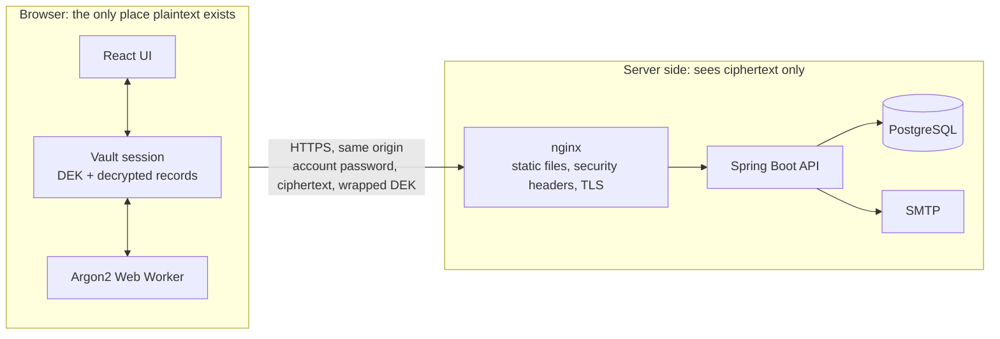
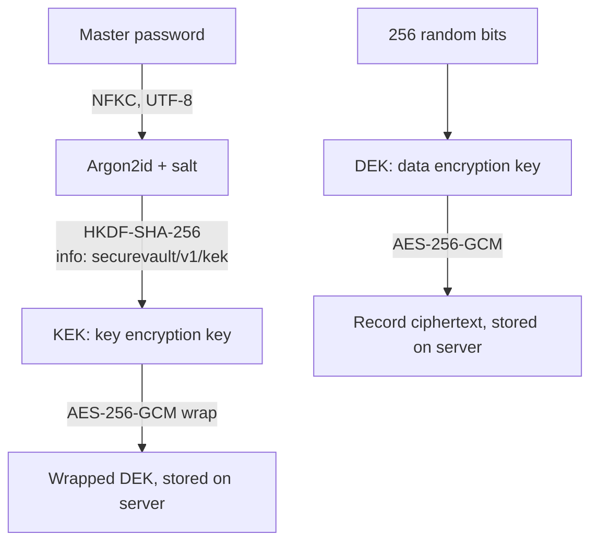
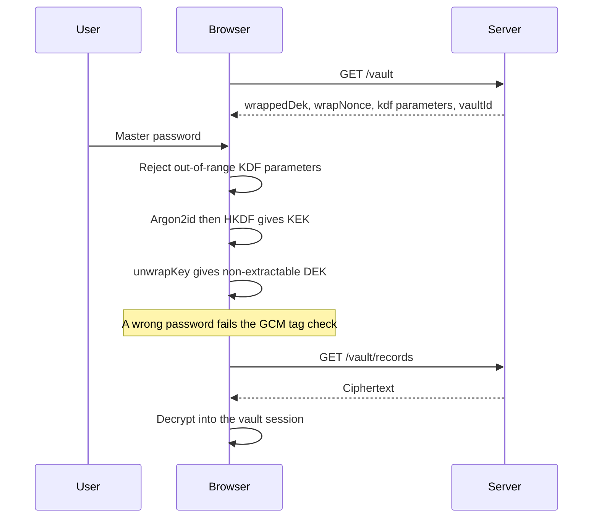

# SecureVault Architecture

**Status:** Implemented. Written in Phase 0 and kept current since; the items still unverified are listed in section 11 and in the [audit](SECURITY_AUDIT.md). For a shorter overview, start with the [security architecture](SECURITY_ARCHITECTURE.md).

## 1. Purpose and principles

SecureVault is a web password manager in which the server stores vault data it cannot read.

| Principle | What it means in practice |
|---|---|
| Zero-knowledge storage | The master password, vault keys, and decrypted entries exist only in the browser |
| Minimal server knowledge | Titles, URLs, categories, tags, and favorites are encrypted too, not only passwords |
| Do not invent crypto | Web Crypto, `hash-wasm`, and Bouncy Castle provide all primitives. Our code only composes them, following a written specification |
| Fail closed | Tampered data, unknown versions, and out-of-range parameters are errors. There are no fallbacks |
| Simple before clever | One deployable backend, one database, same-origin hosting |
| Honest limits | Section 5.10 and `THREAT_MODEL.md` state what the design does not protect against |

## 2. System overview



The browser loads the app and calls the API from one origin. nginx serves the frontend and proxies `/api/`. Same-origin hosting means CORS does not have to be opened at all, which removes a whole class of misconfiguration.

## 3. Technology choices

Versions were checked against npm, Maven Central, and endoflife.date on 2026-11-08.

### Backend

| Component | Version | Notes |
|---|---|---|
| Java (Temurin) | 25 LTS | Supported until 2031; Spring Boot 4.1.2 supports Java 17 through 27 |
| Spring Boot | 4.1.2 | 4.2 is still a release candidate; 4.1 open-source support runs to 2027-07-31 |
| Spring Security | 7.1.2 | Managed by Boot |
| Spring Session JDBC | 4.1.1 | Managed by Boot |
| Hibernate | 7.4.x | Managed by Boot |
| PostgreSQL | 18 | Supported until 2030-11 |
| Flyway | 12.4.0 | Boot-managed version. Newer 13.x exists but would be outside the tested BOM |
| Bouncy Castle `bcprov-jdk18on` | 1.86 | Required by Spring's `Argon2PasswordEncoder` |
| Bucket4j `bucket4j_jdk17-core` | 8.22.0 | Rate limiting. Token buckets are easy to get subtly wrong by hand |
| Caffeine | Boot-managed | Bounded in-memory store for rate-limit buckets |
| Testcontainers | 2.0.5 | Managed by Boot |

### Frontend

| Component | Version | Notes |
|---|---|---|
| Node.js | 26 LTS | 24.15 or newer also works, but 24 left active support in October 2026 |
| React | 19.3 | |
| TypeScript | 6.0.3 | **Not 7.x:** `typescript-eslint` 8.72 requires `<6.1.0` |
| Vite | 8.3 | |
| Tailwind CSS | 4.3 | |
| Native `<dialog>` and small own components | n/a | Replaces shadcn/ui and Radix, which inject `<style>` elements the CSP blocks (ADR 0014) |
| React Router | 8.5 | |
| TanStack Query | 5 | Holds ciphertext only (section 5.9) |
| React Hook Form, Zod | 7.91, 4.6 | |
| `hash-wasm` | **4.12.0, exact pin** | See below |
| `@zxcvbn-ts/core` and language packs | 4.x | Local strength estimation, loaded lazily |
| `lucide-react` | 1.71 | Icons. Toasts are our own `aria-live` region, since `sonner` injects styles |
| Vitest, RTL, MSW, Playwright | 5.1, 16.3, 3.0, 1.65 | MSW and Playwright are dev-only |
| `@noble/hashes` | 2.4 | **Dev-only**, used to cross-check Argon2id output |

**Why `hash-wasm`.** It is actively maintained, MIT licensed, dependency-free, works in Web Workers, accepts `Uint8Array` inputs, and has no published GitHub security advisories. The alternatives: `argon2-browser` has had no release since 2022, and `@noble/hashes` is pure JavaScript, so it is much slower, which forces weaker parameters for the same wait. No independent audit of `hash-wasm` was found, which is why we cross-check its output in tests.

**Why exactly 4.12.0.** Version 4.13.0 was published on 2026-11-07, following a two-year gap. Its release notes and commit list were reviewed on 2026-11-09. It rebuilds all WASM modules with a newer compiler (Clang 17 to 22), so the Argon2 binary has very likely changed, while its listed fixes concern bcrypt, xxHash, and TypeScript types, none of which SecureVault uses. No maintainer change was visible, but the source diff would not render, so it was not read. Upgrading would add risk for no benefit, so 4.12.0 stays pinned. Any future upgrade must pass the cross-implementation vectors.

**Deliberately not used**

| Option | Reason |
|---|---|
| JWT sessions | Hard to revoke; server-side sessions give real logout and "end all sessions" |
| Redis | Not needed for a single instance. Spring Session JDBC reuses PostgreSQL |
| H2 in tests | Behaves differently from PostgreSQL; Testcontainers uses the real thing |
| `springdoc` | The hand-written contract comes first. Reconsider once the API is stable |
| `motion` | CSS transitions are enough for subtle animation |
| Have I Been Pwned | Would involve a third-party service; the requirement says analysis is local |

## 4. Code structure

```
SecureVault/
├── backend/                 Spring Boot application
├── frontend/                React application
├── e2e/                     Playwright journeys
├── docs/                    Architecture, API, database, ADRs
├── .github/workflows/       CI
├── docker-compose.yml
└── .claude/skills/          Project skills
```

**Backend** uses packages by feature (`auth`, `account`, `vault`, `activity`, `mail`, `common`), with controller, service, repository, entity, and DTO layers inside each feature. The feature tells you what code is about; the layer tells you what it is allowed to do. Rules are in the `backend-engineering` skill.

**Frontend** uses `app`, `crypto`, `vault-session`, `features/*`, `components/ui`, `lib`, and `workers`. `crypto` is pure TypeScript with no React, so it can be tested on its own. Rules are in the `frontend-engineering` skill.

## 5. Cryptographic specification, version 1

This section is the authority for all crypto code. Any change to a format requires a new `cryptoVersion`.

### 5.1 Why two passwords and three keys

- **Account password** proves who you are to the server. The server sees it at login and stores only an Argon2id hash.
- **Master password** unlocks the vault. The server never sees it.



The extra DEK layer means changing the master password only re-wraps one 32-byte key instead of re-encrypting every record, and a failed change cannot leave the vault half-converted.

### 5.2 Key derivation

1. Normalize the master password to Unicode NFKC, as NIST SP 800-63B recommends, so the same password typed on different systems produces the same bytes. Then encode as UTF-8. Case is not altered.
2. Run Argon2id version 1.3 in a Web Worker:

| Parameter | Value | Accepted range (client and server) |
|---|---|---|
| Memory | 65,536 KiB (64 MiB) | 65,536 to 1,048,576 KiB |
| Iterations | 3 | 3 to 10 |
| Parallelism | 1 | 1 to 4 |
| Salt | 16 random bytes, unique per derivation setup | exactly 16 bytes |
| Output | 32 bytes | fixed |

3. Derive the KEK with Web Crypto HKDF-SHA-256 using the Argon2id output as input keying material, an empty salt, and `info = "securevault/v1/kek"`. The KEK is non-extractable with usages `wrapKey` and `unwrapKey`.

These settings exceed OWASP's account-password minimum (19 MiB, t=2, p=1) because a stolen vault can be attacked offline with no rate limit. They match the memory and pass count of RFC 9106's second recommended profile, but use one lane, because `hash-wasm` does not document multithreaded Argon2, so more lanes would add time without any defender benefit. Phase 2 will benchmark these on a mid-range phone.

**Why HKDF after Argon2id?** It gives each future derived key its own labeled purpose. Insufficient key separation is one of the design weaknesses named in the password manager research in section 5.11.

### 5.3 The data encryption key

The DEK comes from `crypto.subtle.generateKey` as AES-256-GCM. It is extractable only long enough to be wrapped once. For normal use it is obtained through `unwrapKey` with `extractable: false`, so even our own JavaScript cannot read its raw bytes.

### 5.4 AES-256-GCM rules

- Tag length 128 bits. Nonce 96 bits from `crypto.getRandomValues`, fresh for every encryption.
- Random nonces are safe up to about 2^32 encryptions per key (NIST SP 800-38D). A vault capped at 5,000 records is far below that.
- Every operation includes Additional Authenticated Data (AAD). AAD is not secret. It is checked along with the ciphertext, so a blob only decrypts in the exact place it belongs.

| Use | AAD string (UTF-8) |
|---|---|
| Wrapped DEK | `securevault\|1\|dek-wrap\|{vaultId}\|argon2id\|{memoryKib}\|{iterations}\|{parallelism}\|{saltBase64}` |
| Vault record | `securevault\|1\|record\|{vaultId}\|{recordId}\|{recordType}` |
| Settings | `securevault\|1\|settings\|{vaultId}` |
| Backup file | `securevault\|1\|backup\|` followed by the canonical header (section 5.8) |

All interpolated values are UUIDs, integers, base64, or fixed enum names, none of which can contain `|`, so the encoding is unambiguous.

Binding KDF parameters into the wrap AAD means the server cannot alter them and still have the DEK unwrap correctly. The client also enforces the floor in 5.2 before deriving.

### 5.5 Record format

Each record is one encrypted blob. Fields are never encrypted individually, which prevents a malicious server from swapping, for example, one entry's URL with another's password.

```jsonc
// Plaintext for recordType LOGIN, never sent to the server
{
  "schema": 1,
  "title": "...", "username": "...", "email": "...", "password": "...",
  "urls": ["https://..."], "notes": "...",
  "categoryId": "uuid-or-null", "tags": ["..."], "favorite": false,
  "passwordUpdatedAt": "2026-11-08T12:00:00Z"
}
```

A `CATEGORY` record contains `{ "schema": 1, "name": "..." }`. A login whose `categoryId` no longer exists is shown as uncategorized, so deleting a category does not require re-encrypting entries.

**Padding.** To avoid revealing the length of secrets, the plaintext is laid out as a 4-byte big-endian length, the UTF-8 JSON, and zero bytes up to the next multiple of 256 bytes. After decryption the client validates the length and the zero bytes.

Record IDs are UUIDs generated by the client, because the ID must be known before encryption to go into the AAD.

### 5.6 Main flows

**Unlock**



The master password has no server-side verifier. The successful GCM unwrap is the proof. Nothing derived from the master password is ever sent, so there is no server-side value to attack beyond the wrapped DEK itself.

**Master password change.** The user supplies the current master password, the new one, and the account password. The client unwraps the DEK as extractable, derives a new KEK with a fresh salt, re-wraps the DEK, and sends the new material with `expectedKeyVersion`. The server replaces it atomically. Records are untouched.

Limitation: the DEK itself does not change. Someone who already obtained the old wrapped DEK and the old master password can still decrypt the vault. Full DEK rotation is planned future work and is called out in the threat model.

**Forgotten master password.** There is no recovery. The only option is a typed-confirmation vault reset that destroys all records and creates a new vault. Forgetting the *account* password is different: the email reset works and the vault remains intact, because the wrapped DEK is unrelated to the account password.

### 5.7 Keeping the two passwords separate

If a user sets both passwords to the same value, the server would receive the master password at login, breaking the model. Mitigations:

- Registration collects both in one wizard, so the client can compare them while both are in memory and reject a match.
- Account password change: the client fetches the wrapped DEK, derives a candidate KEK from the new account password, and attempts to unwrap. Success means they are identical, so the change is rejected.
- Master password change also requires the account password, enabling a direct comparison.

Residual risks:

- The email reset flow has no session, so the client cannot fetch the wrapped DEK to run this check. A user could set the account password equal to the master password through reset. The reset page warns against this.
- Nothing stops a user from typing the master password into the login form by mistake. The two screens are worded and styled distinctly to reduce this.

### 5.8 Encrypted backup

The export is a JSON file with a header containing format version, KDF parameters, salt, and nonce, followed by one ciphertext. The file is `{ "header": { "format": "securevault-backup", "version": 1, "kdf": {...}, "nonce": "..." }, "ciphertext": "..." }`. The canonical header is rebuilt from the parsed values in a fixed key order, so key order in the file does not matter but every value does. The contents are padded like records, up to 64 MiB. The key comes from a dedicated backup passphrase through Argon2id and HKDF with `info = "securevault/v1/backup"`. The header's canonical JSON is included in the AAD. Import decrypts locally, re-encrypts every record under the current DEK with new IDs, and uploads through the batch endpoint. Plaintext export is deliberately not offered.

### 5.9 Vault lifecycle in memory

- The DEK lives in module scope in `vault-session`, and decrypted records live in its store. Neither goes into React state, TanStack Query, or any browser storage.
- A page refresh destroys both, so the user must unlock again. This is intended.
- **Lock triggers:** inactivity (default 5 minutes, configurable from 1 to 60), manual lock, logout, HTTP 401, and a `BroadcastChannel` lock message from another tab. The message carries no key material.
- **On lock:** drop the DEK reference, clear the store, clear vault query caches, cancel timers, and overwrite held buffers.

JavaScript cannot guarantee that strings are erased from memory. Cleanup reduces exposure and is described only as best-effort.

Clipboard copies are overwritten after 30 seconds where the browser permits it and the page has focus. Other applications, clipboard history, and backgrounded tabs can defeat this.

### 5.10 What this design does not protect against

- **A compromised server delivering modified JavaScript.** This is the fundamental limit of any web-delivered crypto. Malicious code would capture the master password at the next unlock. CSP and same-origin hosting reduce injection risk, but cannot defend against the party that serves the code.
- XSS while unlocked, malware or malicious extensions in the browser, and a weak master password if the database is stolen.
- Rollback or deletion of records by a malicious server. GCM stops forgery and relocation of records, but not replaying an older valid copy or removing one.
- Metadata visible to the server: record count, 256-byte size buckets, timestamps, and access patterns.

### 5.11 Lessons taken from published research

Scarlata, Torrisi, Backendal, and Paterson (USENIX Security 2026, IACR ePrint 2026/058) analyzed four commercial password managers under a malicious server. Only the abstract and project summary were readable during research, as the paper's PDF could not be downloaded. The attack categories map to this design as follows:

| Attack category | SecureVault response |
|---|---|
| Key escrow and account recovery | No escrow and no recovery feature exists |
| Flawed item-level encryption, field swapping | One AEAD blob per record, with identity bound by AAD |
| KDF downgrade | Client-enforced floor, parameters bound in wrap AAD |
| Unauthenticated public keys in sharing | No sharing and no public-key crypto in version 1 |
| Backward compatibility downgrades | One version, no legacy modes, unknown versions rejected |
| Whole-vault integrity | **Not solved.** Listed as a residual risk |

## 6. Authentication and sessions

| Topic | Decision |
|---|---|
| Account password hash | `Argon2PasswordEncoder(16, 32, 1, 19456, 2)`, set explicitly because Spring's current default is 16 MiB, below OWASP's 19 MiB minimum |
| Hashing concurrency | Bounded so a login flood cannot exhaust memory |
| Session | Opaque server-side session in PostgreSQL through Spring Session JDBC. The principal name is the user UUID, so email addresses stay out of the session table |
| Cookie | `__Host-SV_SESSION; HttpOnly; Secure; SameSite=Strict; Path=/` in production. Local HTTP uses `SV_SESSION` without `Secure`. Set by an explicit `CookieSerializer` bean, because Boot applies `server.servlet.session.cookie.*` only when it runs an embedded server, so tests would otherwise check a different cookie |
| Anonymous sessions | Created only by `GET /auth/csrf`, with a 10-minute idle timeout. A wrapper around the CSRF token repository stops other anonymous requests from creating one |
| Timeouts | Idle 30 minutes, absolute 8 hours (enforced by a small filter, as Spring Session only tracks idle time) |
| Rotation | New session ID at login; all sessions ended on account password reset; other sessions ended on password change |
| CSRF | Session-stored synchronizer token with Spring's default XOR masking, delivered by `GET /auth/csrf` and held in memory by the client |
| Defense in depth | Filter rejecting state-changing requests with `Sec-Fetch-Site: cross-site` or a mismatched `Origin` |
| CORS | No cross-origin access. Vite's dev proxy keeps development same-origin too |
| Step-up | Account password required again for master password change, vault reset, and account deletion |

**Why not `csrf.spa()`?** Spring's documentation presents it as a cookie-based setup. OWASP now marks unsigned double-submit cookies as discouraged and recommends the synchronizer pattern for stateful applications, which is Spring's session-backed default.

**Why `SameSite=Strict` works for an SPA.** Following a link from an email does not send the cookie on the initial HTML load. That does not matter here: the HTML is public, and the app's subsequent API calls are same-site and do include the cookie.

### Email flows

Verification and reset tokens are 256 random bits, stored only as SHA-256 hashes, and single use. A fast hash is appropriate here because the input is high-entropy random data rather than something a person chose. Reset tokens last 30 minutes and verification tokens 24 hours.

Links place the token in the URL **fragment** (`/reset-password#token=...`). Fragments are not sent to servers or included in referrers, and the app strips the token from the address bar immediately. Link domains come from configuration, never the `Host` header.

### Registration and account enumeration

Registration always returns the same 202 response. If the email is already registered, the submitted material is discarded, a dummy hash equalizes timing, and the owner gets a notification email instead. Unverified accounts are purged after 24 hours so an attacker cannot pre-claim someone's address indefinitely.

## 7. Rate limiting

| Action | Limit |
|---|---|
| Login, per IP and email | 5 per minute |
| Login, per IP | 20 per minute |
| Login, per email across all IPs | 30 per 15 minutes |
| Register, per IP | 5 per hour |
| Forgot password or resend, per email | 3 per hour, always returning the normal response |
| Forgot password or resend, per IP | 10 per hour |
| Token submission, per IP | 10 per hour |
| CSRF token, per IP | 30 per minute, because each anonymous fetch creates a short-lived session |
| Step-up operations, per user | 5 per 15 minutes |
| General authenticated API, per user | 300 per minute |

Throttling answers with HTTP 429 and `Retry-After`; accounts are never hard-locked, as that would let attackers lock out victims. Buckets live in memory, so limits are per instance, a documented limitation if scaled out. The client IP comes from `X-Forwarded-For` only as overwritten by our own nginx.

## 8. Security headers

```
Content-Security-Policy: default-src 'none'; script-src 'self' 'wasm-unsafe-eval'; style-src 'self';
  img-src 'self' data:; font-src 'self'; connect-src 'self'; worker-src 'self'; manifest-src 'self';
  base-uri 'none'; form-action 'self'; frame-ancestors 'none'
Strict-Transport-Security: max-age=31536000; includeSubDomains   (production)
X-Content-Type-Options: nosniff
Referrer-Policy: no-referrer
Cross-Origin-Opener-Policy: same-origin
Cross-Origin-Resource-Policy: same-origin
Permissions-Policy: camera=(), microphone=(), geolocation=(), payment=()
Cache-Control: no-store       (API responses)
```

`'wasm-unsafe-eval'` permits WebAssembly compilation for Argon2id without allowing JavaScript `eval`. Website favicons are intentionally not loaded, since fetching them would reveal vault contents to third parties.

## 9. Deployment

Docker Compose runs `web` (nginx with the built frontend), `api`, `db`, and, in the development profile, Mailpit, which captures outgoing email locally. Only `web` publishes a port. A production deployment needs a TLS-terminating setup, and the `prod` profile refuses to start without secure cookie settings, an explicit public URL, and SMTP configuration.

No production deployment is planned as part of this project, and an independent security assessment would be needed before holding real credentials.

## 10. Decision log

These become individual ADRs in `docs/adr/` during Phase 1.

| # | Decision | Main alternative | Why |
|---|---|---|---|
| 1 | Encrypt all entry fields as one blob | Encrypt only the password | Hides what sites a user has accounts with; prevents field swapping |
| 2 | DEK wrapped by a KEK | Encrypt records with the password-derived key | Master password change is one atomic update |
| 3 | No master password verifier on the server | Send a derived hash | Avoids giving the server anything derived from the master password |
| 4 | Server-side sessions | JWT | Real revocation; tokens stay out of JavaScript |
| 5 | Session-stored CSRF token | Cookie double-submit | OWASP guidance for stateful applications |
| 6 | Same-origin hosting | Separate API domain | No CORS surface; `__Host-` cookies work |
| 7 | Client-generated record UUIDs | Server-generated IDs | Identity must be known before encryption |
| 8 | Combined registration wizard | Separate setup after login | No half-provisioned accounts; allows comparing passwords |
| 9 | One `vault_records` table with a type | One table per kind | Server treats all as opaque; no duplicated CRUD |
| 10 | Settings stored encrypted | Plaintext server column | Server cannot silently weaken auto-lock |
| 11 | Email verification required | Log in immediately | Needed for enumeration-safe registration and reliable reset |
| 12 | Hand-written API contract | Generated OpenAPI first | Contract is designed before code exists |

## 11. Still unverified

Node 26 compatibility, the hash-wasm 4.13 review, cookie naming, and the CSP behavior of UI libraries were settled during the build and are no longer listed.

| Item | Planned for phase |
|---|---|
| Benchmark KDF on a mid-range phone; revise before any data format ships. Measured so far, 2026-11-10, with `npm run benchmark` under the production CSP: laptop with Intel i5-12450H, Chromium 152, median 223 ms over 5 runs. **No phone measured yet** | 2 |
| Feasibility of adding `require-trusted-types-for 'script'` to the CSP. Not tried in a browser; the Web Worker URL would need a policy first | 4 |
| Read the full ePrint 2026/058 paper and update section 5.11. The PDF could not be downloaded on two attempts, most recently 2026-11-11 | 2 |

## References

- [OWASP Cheat Sheet Series](https://cheatsheetseries.owasp.org/) (Password Storage, Session Management, CSRF, Forgot Password)
- [RFC 9106, Argon2](https://www.rfc-editor.org/rfc/rfc9106), [RFC 5869, HKDF](https://www.rfc-editor.org/rfc/rfc5869), [RFC 9457, Problem Details](https://www.rfc-editor.org/rfc/rfc9457)
- [NIST SP 800-38D, GCM](https://csrc.nist.gov/pubs/sp/800/38/d/final), [NIST SP 800-63B](https://pages.nist.gov/800-63-4/sp800-63b.html)
- [Spring Security CSRF documentation](https://docs.spring.io/spring-security/reference/servlet/exploits/csrf.html)
- [Zero Knowledge (About) Encryption, ePrint 2026/058](https://eprint.iacr.org/2026/058) and [project summary](https://zkae.io/)
