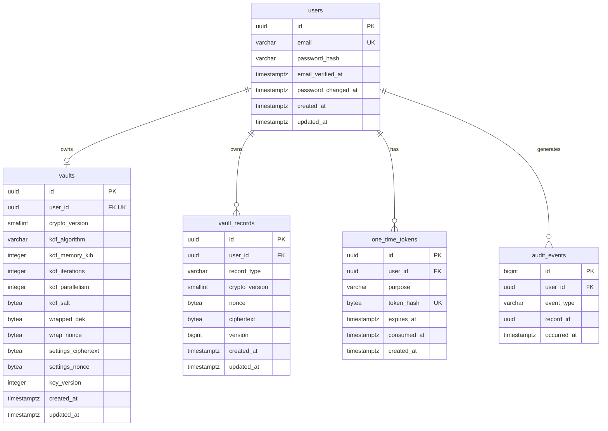

# SecureVault Database Design

**Status:** Phase 0 design. PostgreSQL 18, managed by Flyway. Hibernate runs with `ddl-auto=validate`, so only migrations can alter the schema.

## Design principle

No column may hold plaintext vault content. If a value is meaningful only to the user, it belongs inside `ciphertext`.

## Entity relationships

Spring Session's standard `SPRING_SESSION` and `SPRING_SESSION_ATTRIBUTES` tables are also created by migration. `spring.session.jdbc.initialize-schema` is `never`, so Flyway stays the only schema owner.

## Tables

### `users`

| Column | Type | Constraints | Notes |
|---|---|---|---|
| `id` | `uuid` | PK | Server generated |
| `email` | `varchar(254)` | NOT NULL, UNIQUE | Normalized before storage. Java uses `toLowerCase(Locale.ROOT)`: on a Turkish-locale machine, plain `toLowerCase()` converts `I` to dotless `ı`, which would produce a different address |
| `password_hash` | `varchar(255)` | NOT NULL | Argon2id encoded string containing its own parameters |
| `email_verified_at` | `timestamptz` | NULL | NULL means unverified |
| `password_changed_at` | `timestamptz` | NOT NULL | |
| `created_at`, `updated_at` | `timestamptz` | NOT NULL | |

### `vaults`

One per user. Holds everything needed to unlock.

| Column | Type | Constraints |
|---|---|---|
| `id` | `uuid` | PK, client generated, used in AAD |
| `user_id` | `uuid` | NOT NULL, UNIQUE, FK to `users` ON DELETE CASCADE |
| `crypto_version` | `smallint` | NOT NULL, `CHECK (crypto_version = 1)` |
| `kdf_algorithm` | `varchar(16)` | NOT NULL, `CHECK (kdf_algorithm = 'ARGON2ID')` |
| `kdf_memory_kib` | `integer` | NOT NULL, `CHECK BETWEEN 65536 AND 1048576` |
| `kdf_iterations` | `integer` | NOT NULL, `CHECK BETWEEN 3 AND 10` |
| `kdf_parallelism` | `integer` | NOT NULL, `CHECK BETWEEN 1 AND 4` |
| `kdf_salt` | `bytea` | NOT NULL, `CHECK (octet_length(kdf_salt) = 16)` |
| `wrapped_dek` | `bytea` | NOT NULL, `CHECK (octet_length(wrapped_dek) = 48)` (32-byte key plus 16-byte tag) |
| `wrap_nonce` | `bytea` | NOT NULL, `CHECK (octet_length(wrap_nonce) = 12)` |
| `settings_ciphertext` | `bytea` | NULL, at most 8192 bytes |
| `settings_nonce` | `bytea` | NULL, 12 bytes when set |
| `key_version` | `integer` | NOT NULL, default 1, incremented on master password change |
| `created_at`, `updated_at` | `timestamptz` | NOT NULL |

A `CHECK` ensures `settings_ciphertext` and `settings_nonce` are both null or both set.

### `vault_records`

| Column | Type | Constraints |
|---|---|---|
| `id` | `uuid` | PK, client generated, used in AAD |
| `user_id` | `uuid` | NOT NULL, FK to `users` ON DELETE CASCADE |
| `record_type` | `varchar(16)` | NOT NULL, `CHECK IN ('LOGIN','CATEGORY')` |
| `crypto_version` | `smallint` | NOT NULL, `CHECK (crypto_version = 1)` |
| `nonce` | `bytea` | NOT NULL, `CHECK (octet_length(nonce) = 12)` |
| `ciphertext` | `bytea` | NOT NULL, `CHECK (octet_length(ciphertext) BETWEEN 16 AND 65536)` |
| `version` | `bigint` | NOT NULL, default 1, used for optimistic locking |
| `created_at`, `updated_at` | `timestamptz` | NOT NULL |

Deletes are hard deletes. A soft-deleted row would keep ciphertext around that the user believes is gone.

The 5,000-record quota is checked in a transaction that first locks the user's `vaults` row, so concurrent inserts cannot slip past the limit.

### `one_time_tokens`

| Column | Type | Constraints |
|---|---|---|
| `id` | `uuid` | PK |
| `user_id` | `uuid` | NOT NULL, FK to `users` ON DELETE CASCADE |
| `purpose` | `varchar(24)` | NOT NULL, `CHECK IN ('EMAIL_VERIFICATION','PASSWORD_RESET')` |
| `token_hash` | `bytea` | NOT NULL, UNIQUE, 32 bytes (SHA-256) |
| `expires_at` | `timestamptz` | NOT NULL |
| `consumed_at` | `timestamptz` | NULL |
| `created_at` | `timestamptz` | NOT NULL |

Issuing a new token consumes earlier unconsumed tokens of the same purpose for that user. The raw token exists only in the email. Consumption uses a single conditional `UPDATE ... WHERE consumed_at IS NULL AND expires_at > now()`, which makes it safe when two requests race.

### `audit_events`

| Column | Type | Constraints |
|---|---|---|
| `id` | `bigint` | PK, generated identity |
| `user_id` | `uuid` | NOT NULL, FK to `users` ON DELETE CASCADE |
| `event_type` | `varchar(40)` | NOT NULL, values listed in the API specification |
| `record_id` | `uuid` | NULL, deliberately has no foreign key so history survives record deletion |
| `occurred_at` | `timestamptz` | NOT NULL |

IP addresses and user agents are not stored. Retained for 90 days.

## Indexes

| Index | Purpose |
|---|---|
| `users(email)` unique | Login lookups |
| `vaults(user_id)` unique | Unlock |
| `vault_records(user_id, id)` | Owner-scoped lookup and keyset pagination |
| `one_time_tokens(token_hash)` unique | Token lookup |
| `one_time_tokens(user_id, purpose)` | Invalidate earlier tokens |
| `one_time_tokens(expires_at)` | Purge job |
| `audit_events(user_id, occurred_at DESC)` | Activity feed |
| `audit_events(occurred_at)` | Retention job |
| `users(created_at) WHERE email_verified_at IS NULL` | Purge unverified accounts |

`vault_records` uses keyset pagination because `OFFSET` gets slower as the offset grows and can skip rows when data changes between pages.

## Data lifecycle

| Data | Retention |
|---|---|
| Unverified accounts | Purged after 24 hours |
| Expired or used tokens | Purged after 7 days |
| Audit events | 90 days |
| Sessions | Removed by the Spring Session cleanup job |
| Account deletion | Cascades to all owned rows immediately; database backups age out separately |

Scheduled purge jobs run in the application. Database backups are outside this project, and any real deployment would need its own retention policy for them.

## Planned migrations

| File | Contents |
|---|---|
| `V1__create_users.sql` | `users` |
| `V2__create_vaults.sql` | `vaults` |
| `V3__create_vault_records.sql` | `vault_records` |
| `V4__create_one_time_tokens.sql` | `one_time_tokens` |
| `V5__create_audit_events.sql` | `audit_events` |
| `V6__create_spring_session.sql` | Spring Session tables, copied from the matching release's PostgreSQL schema |

## Why these database choices

- **`bytea` rather than base64 text:** stores a third less data and lets `octet_length` checks validate real byte counts.
- **`timestamptz`:** stores an unambiguous moment in time and avoids time zone bugs.
- **`CHECK` constraints that repeat application validation:** the database remains correct even if a code path has a bug.
- **Foreign keys with cascade:** account deletion cannot leave orphaned ciphertext behind.

## Verification planned

- Migrations are applied to an empty PostgreSQL 18 container in integration tests, and Hibernate's validation has to pass.
- Constraint tests confirm that wrong nonce lengths and out-of-range KDF values are rejected directly by the database.
- The end-to-end suite queries `vault_records` and `vaults` for canary strings and expects none.
