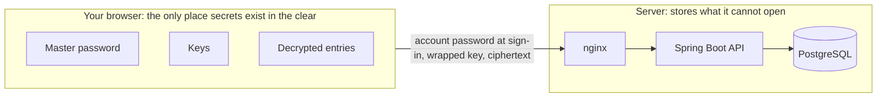
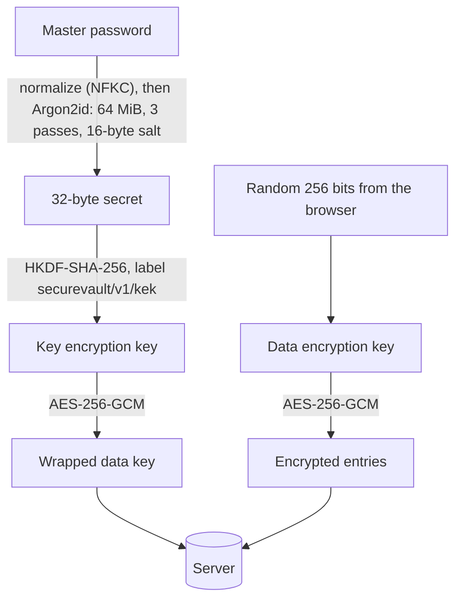

# SecureVault Security Architecture

An overview for a first read. The exact formats and parameters are in the [specification](ARCHITECTURE.md), the attacks considered are in the [threat model](../THREAT_MODEL.md), and what was actually tested is in the [audit](SECURITY_AUDIT.md).

SecureVault has not been independently assessed. This document describes the design and its limits; it does not claim the design is free of flaws.

## The one idea

The server stores your vault but cannot read it. Encryption and decryption happen in your browser, with a key that comes from a password the server never receives.

"Zero-knowledge" here means exactly that: the server has no knowledge of vault contents or of the master password. It does not mean the server knows nothing at all. It knows your email address, how many entries you have, roughly how large each is, and when they change.

## Trust boundaries

| Crosses to the server | Never crosses |
|---|---|
| Email address | Master password |
| Account password, at sign-in only; stored as an Argon2id hash | Anything derived from the master password |
| The wrapped data key and its public parameters | The key encryption key and the data encryption key |
| Ciphertext of entries, categories, and settings | Entry names, usernames, passwords, websites, notes, tags, categories |

The end-to-end test checks the right-hand column on every run by planting unique markers and searching the network traffic, the database, and the logs for them.

## Two passwords

| | Account password | Master password |
|---|---|---|
| Purpose | Proves who you are to the server | Unlocks the vault on your device |
| Seen by the server | Yes, when you sign in | Never |
| Stored | As an Argon2id hash (19 MiB, 2 passes) | Nowhere |
| If forgotten | Reset by email; the vault is untouched | The vault is lost. A reset creates a new, empty one |

They must be different. If they matched, the server would see the master password at every sign-in. The app rejects a match at sign-up, when either password is changed, and at vault reset. It cannot check during an email-based reset, which is noted as a remaining risk.

## Keys

- **Argon2id** makes each guess at the master password cost time and 64 MiB of memory, which slows an attacker who has stolen the database. It runs in a Web Worker.
- **Two layers of keys** mean a master password change re-wraps one 32-byte key and leaves every entry as it is.
- **The data key is non-extractable** once unlocked: the browser will use it but will not hand its bytes to JavaScript, including this app's own code.
- **Parameters are checked on the device** against a built-in minimum before any derivation, and are bound into the wrapped key, so the server cannot quietly weaken them.

## Entries

Each entry is one AES-256-GCM blob containing every field. The server sees a random ID, a type (`LOGIN` or `CATEGORY`), a nonce, and ciphertext.

- **Fresh 96-bit random nonce** for every encryption.
- **Bound to its place.** The vault ID, the entry ID, and the type are authenticated with the ciphertext. Moving a blob to another entry, type, or vault makes decryption fail, so a server cannot swap one entry's contents into another.
- **Padded** to a multiple of 256 bytes, so length reveals little.
- **Checked after decryption.** Contents must match a schema before the app uses them.
- **One version.** An unknown format version is an error. There is no fallback to an older or weaker format.

## Unlocking and locking

Unlocking derives the key, unwraps the data key, then downloads and decrypts the entries. A wrong master password makes the unwrap fail; there is nothing on the server to compare against.

The key and the decrypted entries live in the memory of one browser tab. They are not put in `localStorage`, `sessionStorage`, IndexedDB, cookies, or URLs. Reloading the page discards them.

The vault locks after inactivity (5 minutes by default), from the header control, at sign-out, when the server ends the session, and when another tab locks. Locking drops the key and the decrypted entries and clears any password waiting on the clipboard. JavaScript cannot guarantee that memory is erased, so this limits exposure and does not eliminate it.

## The server's own defenses

These protect the account and the stored ciphertext. They do not protect vault contents, which the encryption already covers.

| Area | What is in place |
|---|---|
| Sessions | Server-side, in a cookie JavaScript cannot read, `SameSite=Strict`. New ID at sign-in. Ends after 30 minutes idle or 8 hours |
| Cross-site requests | A token tied to the session, plus checks on `Origin` and `Sec-Fetch-Site` |
| Sensitive actions | Master password change, vault reset, and account deletion ask for the account password again |
| Guessing | Rate limits per IP, per email, and per user. Accounts are throttled, not locked |
| Account discovery | Registration, sign-in, and reset answer the same way for known and unknown emails |
| Email links | 256-bit single-use tokens in the URL fragment, stored only as a hash |
| Other users' data | Every query is scoped to the signed-in user; someone else's record answers "not found" |
| Browser | Content Security Policy with no inline scripts or styles, no third-party origins, and no framing |

## What this does not protect against

- **Modified code from a compromised server.** The browser runs whatever the server sends. Altered JavaScript could capture the master password at the next unlock. This is the main limit of any web-delivered password manager.
- **Script running in the page while unlocked,** malware, or a malicious extension. They can read what you can.
- **A weak master password** after a database theft. Argon2id slows guessing; it cannot rescue a poor password.
- **Rollback and deletion.** A malicious server cannot forge or relocate entries, but it can return an older valid copy or withhold one.
- **Metadata.** Entry count, size buckets, timing, and your email address are visible to the server.
- **A forgotten master password.** There is no recovery.

## Where to look in the code

| Topic | Location |
|---|---|
| Key derivation, wrapping, entry encryption | `frontend/src/crypto/` |
| The unlocked vault, locking, clipboard | `frontend/src/vault-session/` |
| Sessions, CSRF, origin checks, rate limits | `backend/src/main/java/com/securevault/common/` |
| Sign-in, registration, email tokens | `backend/src/main/java/com/securevault/auth/` |
| Encrypted record storage | `backend/src/main/java/com/securevault/vault/` |
| Zero-knowledge end-to-end test | `e2e/tests/journey.spec.ts` |
